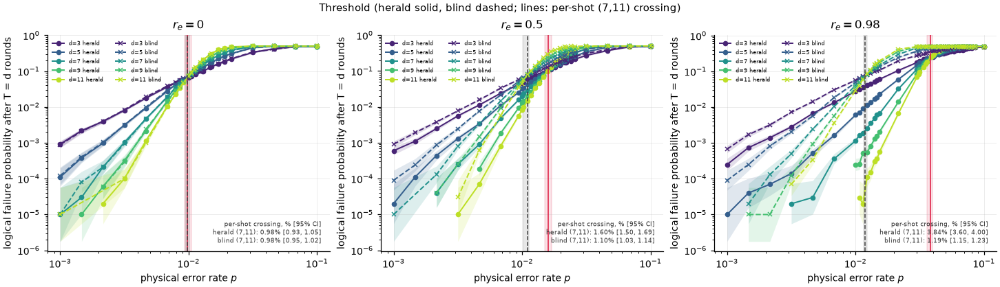
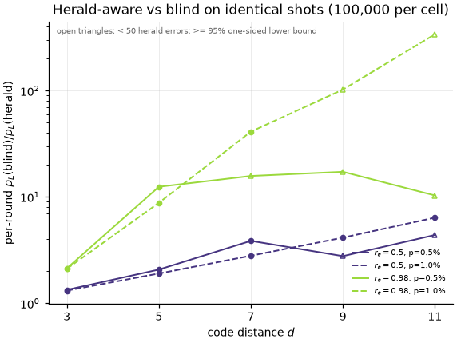
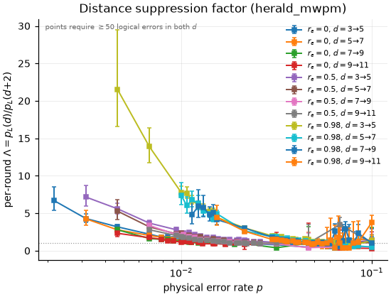
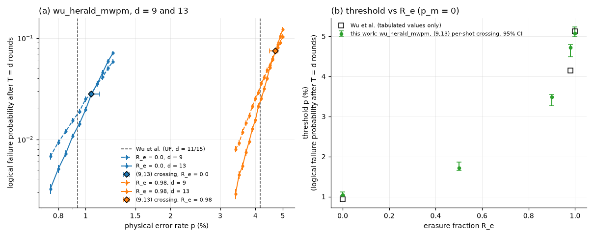

# Herald-conditioned decoding of the erasure-converted rotated surface code

This repository simulates a distance-`d` rotated surface-code Z memory in which a fraction `r_e` of each two-qubit gate's error probability `p` becomes heralded erasure.
A herald-conditioned matching decoder sets the edges of each heralded erasure to weight 0, and a blind decoder ignores the heralds.
At `r_e = 0.98` the per-shot `d = 7` and `d = 11` curves cross at 3.84% [3.60, 4.00] for herald and 1.19% [1.15, 1.23] for blind (bootstrap 95% CI, `scripts/headline_results.py`).

## Results

Rates are logical failure probabilities, per shot (`P_L`) or per round (`p_L`) as defined under [Metric](#metric).
Tables are rendered from `results/*.json` by `scripts/render_readme_tables.py`, and estimators are defined in [docs/METHODS.md](docs/METHODS.md).

### Thresholds

The headline estimate is the first crossing of the per-shot `d = 7` and `d = 11` curves inside the listed grid bracket ([method](docs/METHODS.md#pairwise-crossing-and-bracket)).
Its 95% CI is a parametric bootstrap (`n_boot = 1000`, `seed = 0`, `scripts/headline_results.py`).
The CI covers binomial noise only, not interpolation error inside the bracket.

<!-- BEGIN:thresholds -->
| `r_e` | decoder | per-shot (7,11) crossing, % [95% CI] | bracket, % | sign changes (unsaturated) | per-shot collapse `d ≥ 7`, % [95% CI] | gap collapse − pairwise (pp) | per-round collapse `d ≥ 7` (secondary), % [95% CI] |
|---|---|---|---|---|---|---|---|
| 0 | blind_mwpm | 0.98 [0.95, 1.02] | [0.91, 1.00] | 2 | 0.98 [0.96, 1.00] | -0.004 | 1.44 [1.36, 1.58] |
| 0 | herald_mwpm | 0.98 [0.93, 1.05] | [0.91, 1.00] | 1 | 0.96 [0.94, 0.98] | -0.018 | 1.37 [1.33, 1.46] |
| 0.5 | blind_mwpm | 1.10 [1.03, 1.14] | [1.10, 1.18] | 1 | 1.09 [1.07, 1.11] | -0.017 | 1.48 [1.44, 1.80] |
| 0.5 | herald_mwpm | 1.60 [1.50, 1.69] | [1.57, 1.68] | 1 | 1.57 [1.54, 1.60] | -0.025 | 2.33 [2.21, 2.73] |
| 0.98 | blind_mwpm | 1.19 [1.15, 1.23] | [1.14, 1.23] | 1 | 1.18 [1.16, 1.21] | -0.010 | not resolved (unresolved_ci) |
| 0.98 | herald_mwpm | 3.84 [3.60, 4.00] | [3.60, 3.87] | 1 | 3.83 [3.74, 3.94] | -0.016 | not resolved (bound_pin) |

CI endpoints can move in the second decimal with the NumPy version.
<!-- END:thresholds -->

The per-shot collapse fit [[9]](#references) over `d ∈ {7, 9, 11}` ([method](docs/METHODS.md#collapse-fit)) lies below the pairwise crossing in all six conditions, by 0.004 to 0.025 percentage points (pp).
We report the gap as a systematic difference between two estimators, not as an error of either one.

At `r_e = 0.5` the blind (7,11) estimate, 1.10% [1.03, 1.14], sits at the lower edge of its bracket [1.10, 1.18], and its CI extends below the bracket.
The blind (9,11) crossing is 1.03% [1.02, 1.19] (`results/headline.json`).
The `r_e = 0.5` blind value should be quoted only with its CI.
Its per-round CI upper endpoint, 1.80%, coincides with the sweep grid point `p = 0.018`.

At `r_e = 0.98` the per-shot collapse fit resolves both thresholds, and the per-round fit resolves neither (`bound_pin`, `unresolved_ci`; [criteria](docs/METHODS.md#collapse-fit)).
This is an observation about two fits; it makes no claim about which metric is correct.



*Per-shot `P_L` against `p` for `d ∈ {3, 5, 7, 9, 11}`, one panel per `r_e`, herald solid and blind dashed.*
*Lines and bands mark each decoder's (7,11) crossing and 95% CI; a missing or saturated crossing has no line.*

### Herald minus blind

The table gives herald − blind of the per-shot (7,11) crossings, with a 95% unpaired-bootstrap CI (`scripts/headline_results.py`).

<!-- BEGIN:herald_vs_blind -->
| `r_e` | herald (7,11), % | blind (7,11), % | herald − blind (pp) [95% CI] | replicates missing or saturated | note |
|---|---|---|---|---|---|
| 0 | 0.98 [0.93, 1.05] | 0.98 [0.95, 1.02] | 0.00 [-0.06, 0.07] | 0 / 1000 | control: no heralds |
| 0.5 | 1.60 [1.50, 1.69] | 1.10 [1.03, 1.14] | 0.49 [0.40, 0.60] | 0 / 1000 |  |
| 0.98 | 3.84 [3.60, 4.00] | 1.19 [1.15, 1.23] | 2.65 [2.43, 2.80] | 0 / 1000 |  |

CI endpoints can move in the second decimal with the NumPy version.
<!-- END:herald_vs_blind -->

At `r_e = 0` there are no heralds, and the difference is consistent with zero, as a control requires.
The sweeps sample each decoder on its own shots ([bootstrap](docs/METHODS.md#bootstrap)).
With positively correlated failures a paired CI on shared shots would be narrower, so this CI is conservative relative to it.
We make no causal claim about why the blind crossing moves less with `r_e` than the herald crossing.

### Ablation

`scripts/ablation_table.py` (`results/ablation.json`) decodes the same sampled shots with both decoders, so the ablation is paired by construction and needs no threshold fit.
It does not depend on how the noise budget is normalised across `r_e`.
Ratios and `Λ_d` ([Λ](docs/METHODS.md#lambda)) are per round.

<!-- BEGIN:ablation -->
| `p`, % | `r_e` | `d` | herald errors | blind errors | p_L(blind) / p_L(herald) | herald Λ_d | blind Λ_d |
|---|---|---|---|---|---|---|---|
| 0.50 | 0.5 | 3 | 1,344 | 1,793 | 1.3× | 5.11 | 3.29 |
| 0.50 | 0.5 | 5 | 441 | 912 | 2.1× | 5.63 | 3.02 |
| 0.50 | 0.5 | 7 | 110 | 424 | 3.9× | — | 3.00 |
| 0.50 | 0.5 | 9 | 42 | 182 | > 3× † | — | 2.42 |
| 0.50 | 0.5 | 11 | 9 | 92 | > 4× † | — | — |
| 0.50 | 0.98 | 3 | 771 | 1,635 | 2.1× | 21.16 | 3.62 |
| 0.50 | 0.98 | 5 | 61 | 756 | 12.5× | — | 3.53 |
| 0.50 | 0.98 | 7 | 9 | 301 | > 16× † | — | 3.31 |
| 0.50 | 0.98 | 9 | 1 | 117 | > 17× † | — | 2.75 |
| 0.50 | 0.98 | 11 | 0 | 52 | > 10× † | — | — |
| 1.00 | 0.5 | 3 | 4,828 | 6,290 | 1.3× | 2.48 | 1.72 |
| 1.00 | 0.5 | 5 | 3,261 | 6,065 | 1.9× | 2.26 | 1.54 |
| 1.00 | 0.5 | 7 | 2,035 | 5,521 | 2.8× | 1.99 | 1.35 |
| 1.00 | 0.5 | 9 | 1,322 | 5,277 | 4.1× | 2.00 | 1.30 |
| 1.00 | 0.5 | 11 | 810 | 4,971 | 6.4× | — | — |
| 1.00 | 0.98 | 3 | 2,765 | 5,716 | 2.1× | 8.06 | 1.93 |
| 1.00 | 0.98 | 5 | 580 | 4,924 | 8.8× | 7.76 | 1.66 |
| 1.00 | 0.98 | 7 | 105 | 4,169 | 41.2× | — | 1.52 |
| 1.00 | 0.98 | 9 | 23 | 3,543 | > 103× † | — | 1.44 |
| 1.00 | 0.98 | 11 | 3 | 3,016 | > 339× † | — | — |

100,000 shots per cell, seed 0; error counts are out of 100,000 shots. † fewer than 50 herald errors: >= 95% one-sided lower confidence bound, not a point ratio. Λ_d = per-round p_L(d) / p_L(d+2); — below 50 errors at d or d+2.

CI endpoints can move in the second decimal with the NumPy version.
<!-- END:ablation -->



Below 50 herald errors (†) a cell shows blind's Wilson lower limit over herald's Wilson upper limit, both per round, not a point ratio.
By Bonferroni this is a ≥ 95% one-sided lower bound on that cell's ratio ([Wilson bounds](docs/METHODS.md#wilson-bounds)).
The bound is per cell and not simultaneous across the table.
It ignores the positive correlation from decoding identical shots, which only makes it looser.
At single-digit counts the Wilson "95%" is a nominal approximation with no guaranteed coverage.

At `p = 1.0%` and `r_e = 0.98` the `d = 9` cell has 23 herald errors (3,543 blind) and the `d = 11` cell has 3 (3,016 blind).
**The `d = 11` bound > 339× rests on 3 herald errors and is weak evidence.**
It reads as "herald errors were too rare to measure at `d = 11`", not as "suppression is 339×".
At `p = 0.5%` and `r_e = 0.98` the `d = 7`, 9 and 11 cells have 9, 1 and 0 herald errors (301, 117 and 52 blind).
At `r_e = 0.98`, `p = 0.5%` and `d ≥ 7`, herald failures were too rare to measure at 100,000 shots.
At `p = 0.5%` and `r_e = 0.5` the `d = 9` and 11 cells have 42 and 9 herald errors (182 and 92 blind).
No trend is read across the bounds.

For each pair of `p` and `r_e`, the ungated ratios increase with `d`.
In every cell that reports both, herald `Λ_d` exceeds blind `Λ_d`.
How far the increase continues in the gated cells is bounded from below by this run but not measured by it.
Measuring it needs more shots per cell, not larger distances.



*Per-round `Λ` against `p` from the threshold sweeps, with bootstrap CIs.*
*A point is shown only where both `d` and `d + 2` have at least 50 observed errors.*

## Validation against Wu et al.

The `wu2022` convention reproduces the noise model of Wu et al. [[6]](#references) ([definition](docs/METHODS.md#wu2022)).
`R_e` is the erasure fraction of `p`, and `p_m` the ancilla preparation and measurement flip probability.
The table gives the herald crossing of the per-shot `d = 9` and `d = 13` curves (`scripts/wu_validation.py`, `results/wu_validation.json`).

<!-- BEGIN:wu_validation -->
| config | `R_e` | `p_m` | herald (9,13), % [95% CI] | sign changes (unsaturated) | Wu et al. | ours − Wu (pp) | Wu inside CI |
|---|---|---|---|---|---|---|---|
| wu_fig3_re000 | 0 | 0.0 | 1.05 [1.03, 1.12] | 1 | 0.937(4)% | 0.11 | False |
| wu_fig3_re098 | 0.98 | 0.0 | 4.72 [4.49, 4.79] | 1 | 4.15(2)% | 0.57 | False |
| wu_fig3b_re050 | 0.5 | 0.0 | 1.72 [1.66, 1.87] | 1 | not tabulated | — | — |
| wu_fig3b_re090 | 0.9 | 0.0 | 3.48 [3.27, 3.55] | 1 | not tabulated | — | — |
| wu_fig3b_re100 | 1 | 0.0 | 5.08 [4.99, 5.24] | 1 | 5.13% | -0.05 | True |
| wu_si_pm005 | 0.98 | 0.005 | 3.97 [3.89, 4.19] | 3 | 3.80(2)% | 0.17 | False |
| wu_si_pmp | 0.98 | p | 2.66 [2.62, 2.71] | 1 | 2.85(1)% | -0.19 | False |

CI endpoints can move in the second decimal with the NumPy version.
<!-- END:wu_validation -->



Wu's value lies inside our 95% CI for `R_e = 1` only, and outside it for the four other tabulated configs.
The `d` pair (9,13) was set by a pre-registered memory rule ([WU_DPAIR_DECISION.md](docs/remediation/WU_DPAIR_DECISION.md)).
Wu et al. used the (11,15) pair.
Wu simulate the planar XZZX code [[10]](#references); we simulate the rotated CSS code.
Wu state that the XZZX code "performs identically to the standard surface code for the case of unbiased noise".
Both erasure models here are unbiased, and Wu's `d × d` data-qubit array has the same count as our rotated patch.
Wu decode with weighted Union-Find, which they note "is optimal for pure erasure errors" [[11]](#references); we use MWPM with heralded edges at weight 0.
The other differences are in [docs/VALIDATION.md](docs/VALIDATION.md#differences-from-wu-et-al).

The repo-model thresholds under [Results](#results) are not on a comparable footing with Wu's.
The repo model adds measurement, reset and idle noise, while Wu's Figs. 3–4 set `p_m = 0` and "neglect idle errors".
Wu's `R_e` is therefore also their circuit-wide erasure fraction, whereas the repo's `r_e` is not.
No numerical agreement with Wu is claimed for the repo model at any `r_e`, including the `r_e = 0` baseline.
The two models agree only structurally: in both, the herald threshold rises with the converted fraction.

## Model

The circuit is a rotated surface-code Z memory [[1,2,3]](#references) built in Stim [[4]](#references), with `T = d` rounds and circuit-level noise.
Decoding uses PyMatching [[5]](#references) through `sinter`.
Circuit, noise channels, DEM partition and decoders are specified in [docs/METHODS.md](docs/METHODS.md).

### Noise conventions

In the repo convention (`data/*.csv`) a fraction `r_e` of each two-qubit gate's error budget becomes a heralded erasure: the hardware flags which qubit was disturbed and when.
The erasure replaces the qubit with `I/2`, so it is unbiased and is a non-identity error ¾ of the time.
To first order in `p` the per-gate non-identity probability stays `p` for every `r_e` (`tests/test_noise_model.py::test_error_budget_invariance`, [channels](docs/METHODS.md#constant-non-identity-budget)).
So `r_e` converts the budget rather than shrinking it, and `p` is an iso-noise axis.
Measurement, reset and idle locations take unconverted noise at rate `p`.

`r_e` is therefore the two-qubit-gate fraction, not the circuit-wide heralded fraction.
At `r_e = 0.98` the heralded share of the error mass is 0.45, not 0.98 (exact DEM sum, `d = 5`, `p = 0.02`, `scripts/heralded_fraction.py`).

### Metric

The headline metric is `P_L`, the logical failure probability of one shot after `T = d` rounds.
The per-round rate `p_L = ½·[1 − (1 − 2·P_L)^(1/T)]` is a secondary metric.
Which metric is closer to the asymptotic threshold at finite `d` is an empirical question this repository does not settle ([ordering](docs/METHODS.md#ordering-of-per-shot-and-per-round-crossings)).
Thresholds are per-shot, while `Λ` is per-round; each appearance names its metric.

## Limitations

This is an idealized erasure model.
Each assumption below differs from hardware, and the size of its effect on the results was not measured.

- Erasure is injected after the CX, independently per qubit, with no mid-gate or correlated two-qubit erasure.
  Real leakage happens during the gate and can corrupt both qubits together.
- An erased qubit is `I/2` for that instant only and works normally from the next tick.
  A real ¹⁷¹Yb erasure [[7]](#references) leaks the atom out of the qubit subspace until it is re-prepared.
  A single erasure could then degrade many later rounds, which is not modelled.
- Heralds are instantaneous and 100% reliable, with no false positives.
  Real fluorescence heralding has finite fidelity, false positives and negatives, and a latency the decoder must tolerate.
- The erasure is unbiased.
  The Z-biased erasure of Sahay et al. [[8]](#references) would give a further threshold advantage that is not modelled; the advantage here comes from herald-conditioned decoding alone.
- Every threshold is a Z-basis memory threshold under one observable over `logical_z_support(d)`, with only Z-type detectors closing the time boundaries.
  It is not a full X and Z circuit-level, logical-gate or computation threshold.
  Every number in this repository carries the "Z-memory" qualifier.
- MWPM with heralded edges at weight 0 is not maximum-likelihood for erasure.
  The gap to a maximum-likelihood decoder, and whether it grows with `r_e`, was not measured; a peeling or Union-Find decoder [[11,12]](#references) would measure it.

Future directions (imperfect and delayed heralds, other hardware, logical algorithms, alternative decoders) are in [docs/FUTURE_WORK.md](docs/FUTURE_WORK.md).

## Reproduce

All results and figures are computed from the committed sweeps `data/baseline_pauli.csv`, `data/erasure_r50.csv` and `data/erasure_r98.csv`, and from `data/wu/*.csv`.
`sinter.collect` takes no seed, so the sweeps cannot be regenerated shot for shot ([docs/METHODS.md](docs/METHODS.md#seeds)).
Install with `uv sync --group dev` and re-render the README tables with `uv run python scripts/render_readme_tables.py`.
The command for every result, recorded wall times, collection and legacy scripts are in [docs/METHODS.md](docs/METHODS.md#commands-and-wall-times).

## Layout

```
src/erasure_qec/
├── config.py        # NoiseParams, ExperimentConfig, YAML loading
├── circuits/        # layout.py (geometry), scheduling.py (CX schedules), builder.py (emits stim)
├── noise/           # model.py (channel rates), injector.py (repo convention), wu.py (wu2022)
├── decoding/        # dem_partition.py, tagged_partition.py, herald_matching.py, sinter_adapter.py
└── analysis/        # statistics.py, crossing.py, threshold_fit.py, dem_stats.py, synthetic.py, plotting.py
experiments/         # collection drivers and configs/ (repo convention) and configs/wu/ (wu2022)
scripts/             # analyses that write results/*.json, the README table renderer, dev probes
results/             # JSON outputs with git describe, software versions and data sha256
data/                # committed sweeps: *.csv (repo convention), wu/*.csv (wu2022)
figures/             # committed figures
docs/                # METHODS.md, VALIDATION.md, FUTURE_WORK.md, dem_worksheet.md, remediation/, archive/
tests/               # pytest suite; fixtures/ holds pinned CSVs
```

Pinned regression snapshots of real sweeps live at `tests/fixtures/real_*.csv`.
The committed synthetic fixtures `tests/fixtures/synthetic_*.csv` drive the analysis and plotting tests and are not measurements.
They are generated from the same collapse variable the fitter inverts, and the fitter must reject the adversarial one.
History up to `da47e3a` is in [docs/archive/](docs/archive/README.md), and changes are in [CHANGELOG.md](CHANGELOG.md).

## References

1. Dennis, Kitaev, Landahl & Preskill, *Topological quantum memory*, J. Math. Phys. 43, 4452 (2002), [arXiv:quant-ph/0110143](https://arxiv.org/abs/quant-ph/0110143). The surface-code memory.
2. Bombin & Martin-Delgado, *Optimal resources for topological two-dimensional stabilizer codes: comparative study*, Phys. Rev. A 76, 012305 (2007), [arXiv:quant-ph/0703272](https://arxiv.org/abs/quant-ph/0703272). The rotated layout.
3. Tomita & Svore, *Low-distance surface codes under realistic quantum noise*, Phys. Rev. A 90, 062320 (2014), [arXiv:1404.3747](https://arxiv.org/abs/1404.3747). The low-distance rotated layout.
4. Gidney, *Stim: a fast stabilizer circuit simulator*, Quantum 5, 497 (2021), [arXiv:2103.02202](https://arxiv.org/abs/2103.02202).
5. Higgott & Gidney, *Sparse Blossom: correcting a million errors per core second with minimum-weight matching*, Quantum 9, 1600 (2025), [arXiv:2303.15933](https://arxiv.org/abs/2303.15933).
6. Wu, Kolkowitz, Puri & Thompson, *Erasure conversion for fault-tolerant quantum computing in alkaline earth Rydberg atom arrays*, Nat. Commun. 13, 4657 (2022), [arXiv:2201.03540](https://arxiv.org/abs/2201.03540). Noise model: Sec. III and Methods, Sec. VII.A.
7. Ma et al., *High-fidelity gates and mid-circuit erasure conversion in an atomic qubit*, Nature 622, 279 (2023).
8. Sahay, Jin, Claes, Thompson & Puri, *High-threshold codes for neutral-atom qubits with biased erasure errors*, Phys. Rev. X 13, 041013 (2023), [arXiv:2302.03063](https://arxiv.org/abs/2302.03063).
9. Wang, Harrington & Preskill, *Confinement-Higgs transition in a disordered gauge theory and the accuracy threshold for quantum memory*, Ann. Phys. 303, 31 (2003), [arXiv:quant-ph/0207088](https://arxiv.org/abs/quant-ph/0207088).
10. Bonilla Ataides, Tuckett, Bartlett, Flammia & Brown, *The XZZX surface code*, Nat. Commun. 12, 2172 (2021), [arXiv:2009.07851](https://arxiv.org/abs/2009.07851).
11. Delfosse & Zémor, *Linear-time maximum likelihood decoding of surface codes over the quantum erasure channel*, Phys. Rev. Research 2, 033042 (2020), [arXiv:1703.01517](https://arxiv.org/abs/1703.01517).
12. Delfosse & Nickerson, *Almost-linear time decoding algorithm for topological codes*, Quantum 5, 595 (2021), [arXiv:1709.06218](https://arxiv.org/abs/1709.06218).

## Citation

Cite the repository and the commit you used:

```bibtex
@software{erasure_qec,
  author = {Naman},
  title  = {Herald-conditioned decoding of the erasure-converted rotated surface code},
  url    = {https://github.com/albnewt97/erasure-qec},
  note   = {version 0.2.0, commit <hash>},
  year   = {2026}
}
```

## License

MIT — see [LICENSE](LICENSE).
